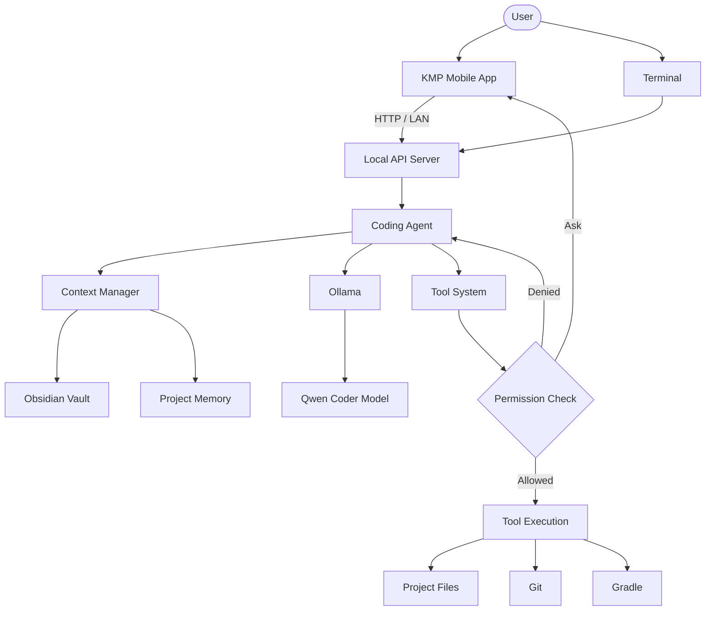
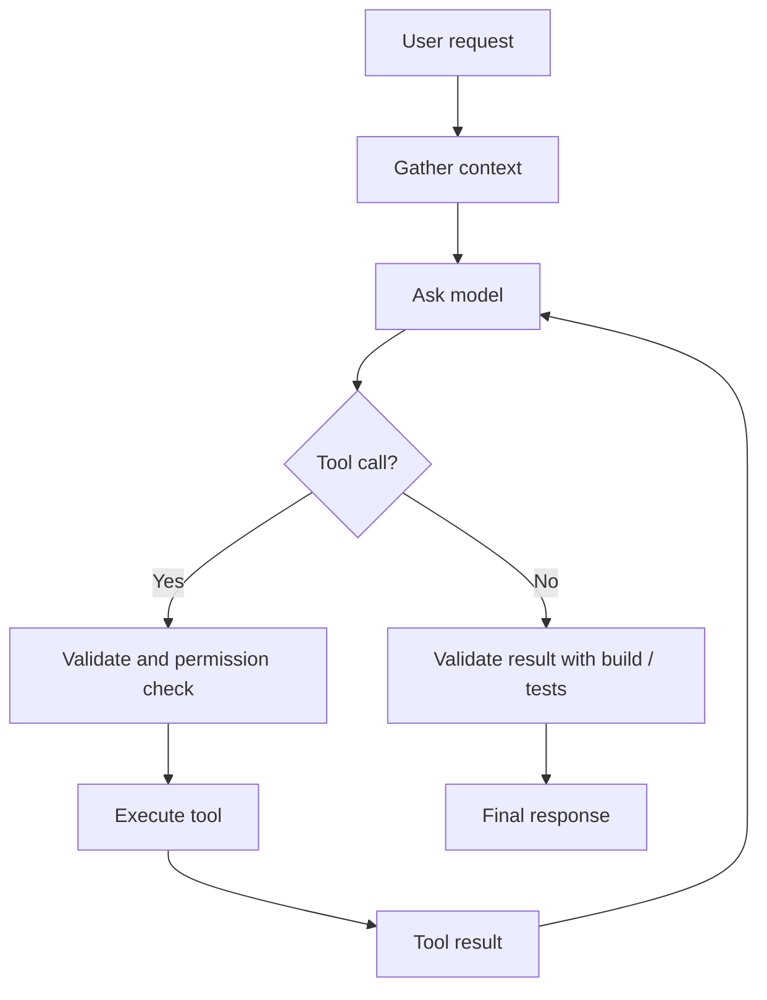

# System Graph

Visual map of the Local AI Coding Assistant. Obsidian renders the diagrams below.

## Components

## Agent Loop

## Notes

- [[📄 System Architecture|System Architecture]]
- [[📄 Agent Architecture|Agent Architecture]]
- [[📄 Agent Loop|Agent Loop]]
- [[📄 Tool Architecture|Tool Architecture]]
- [[📄 Mobile Architecture|Mobile Architecture]]
